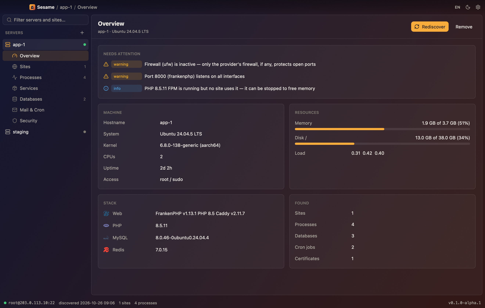
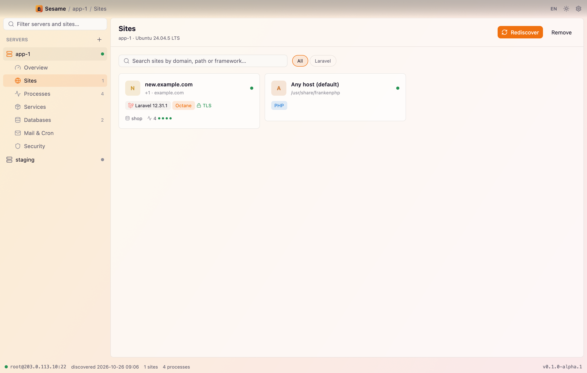
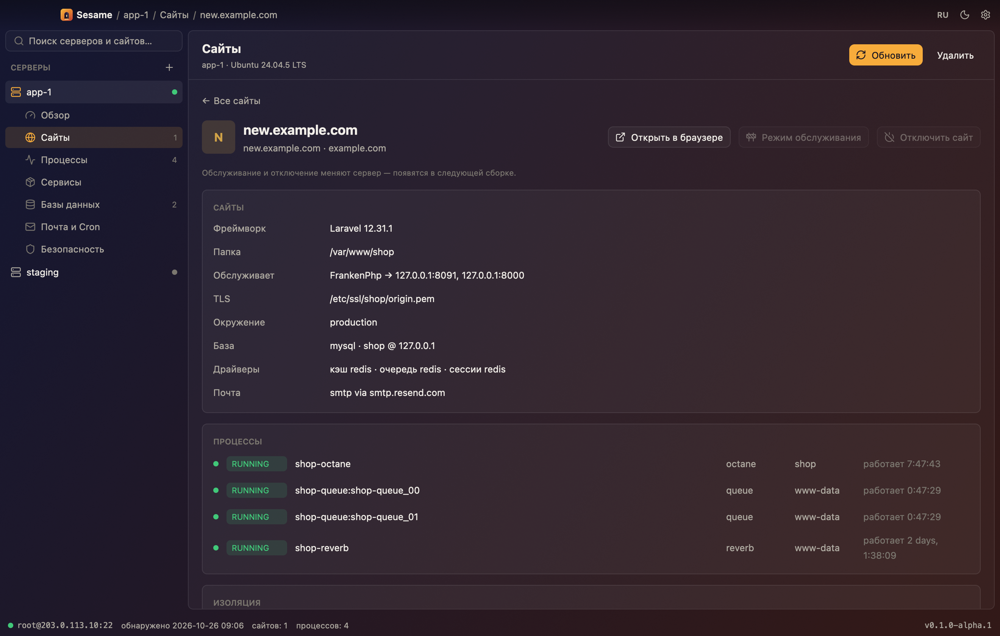
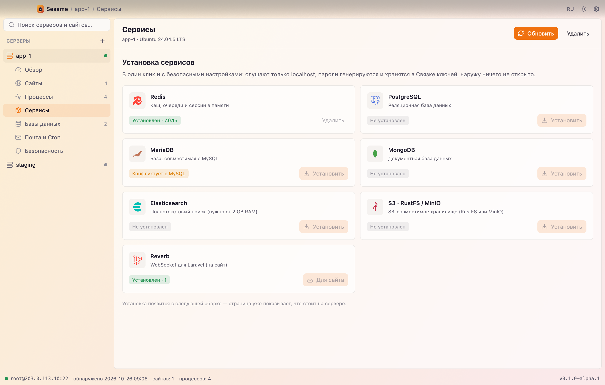

<div align="center">


# Sesame

**Open your servers.**

A native, AI-friendly server manager for the Laravel community.<br>
Give it SSH — it finds every site, database, mail setup and process on the box, and lets you run them.

[](https://github.com/rasul-chopurov/sesame/releases)
[](LICENSE)
[-2A1B3D)](#install)
[](https://github.com/longbridge/gpui-kit)

**English** · [Русский](#русский)

</div>

<p align="center">
  
  
</p>

> **Alpha.** Sesame is at `0.1.0-alpha.1`. Discovery is read-only and well tested. Server changes (services, databases, installs) are previewed, confirmed and audited, but still need wider testing on real servers — try them on a disposable VPS first. See the [roadmap](#roadmap).

## Why

Forge, Ploi and Coolify are web dashboards with an agent on your server. Sesame is the other way around: a **fast native app on your Mac** that talks to your servers over plain SSH. Nothing to install on the server, no Electron, no JVM — it starts instantly and stays light.

It is built for how Laravel actually runs in production today: FrankenPHP and Octane, Reverb, Horizon and queue workers under supervisor, Redis, MySQL or Postgres, Cloudflare in front.

## What it does today

| | |
|---|---|
| 🔑 **Connect** | ssh-agent, key file or password (encrypted in a local vault). Host keys verified against `~/.ssh/known_hosts`; a changed key refuses to connect. |
| 🔍 **Discover** | One read-only probe, two SSH round trips: OS and resources · systemd and supervisor (Octane, queue, Horizon, Reverb recognised) · listening ports · sites from **FrankenPHP/Caddy, Nginx, Apache** · Laravel and WordPress with non-secret `.env` details · MySQL, MariaDB, PostgreSQL, Redis, MongoDB · mail · PHP and FPM pools · cron · certificates and expiry · ufw and fail2ban · Docker. |
| 🚨 **Needs attention** | Failed processes, ports open to the world, inactive firewall, expiring certificates, PHP-FPM running for nobody, full disks. |
| 🤖 **AI agents** | `sesame mcp` for Claude Code, Claude Desktop and Cursor; `sesame serve` for REST. 30 tools; reading is immediate, every change waits for **Allow** in the app and lands in the audit log with the agent's name. |
| ✉️ **Mail** | Resend in one click: domain, DKIM/SPF in Cloudflare, verification and a domain-limited key in the site's `.env`. Stalwart mail server in the services catalog. |
| ⌘ **Command palette** | ⌘K jumps to any server, section, site or action. |
| 🎨 **Glass UI, EN / RU / AZ** | Translucent light and dark themes over a blurred window, breadcrumbs in the titlebar, a sidebar tree with search, sites as searchable cards. English, Russian and Azerbaijani. |
| ⬆️ **Updates** | Checks GitHub Releases, shows the changelog of every version since yours, installs signed builds automatically if you want. |
| 🔒 **Safe by default** | Discovery never changes anything and never reads passwords or keys from `.env`. |

<p align="center">
  
  
</p>

## Install

Prebuilt builds will appear on the [Releases](https://github.com/rasul-chopurov/sesame/releases) page. Until the app is notarized, clear the quarantine flag after copying it to Applications:

```sh
xattr -dr com.apple.quarantine /Applications/Sesame.app
```

### Build from source

Requires Rust (`rustup`) and Xcode on macOS (GPUI uses Metal).

```sh
git clone https://github.com/rasul-chopurov/sesame && cd sesame
cargo run -p sesame-app --release
```

## CLI

The same binary is a CLI — handy for scripts and AI agents:

```sh
sesame add prod root@203.0.113.10        # save a server (ssh-agent by default)
sesame add prod deploy@host:2222 --key ~/.ssh/id_ed25519
sesame servers                           # list saved servers
sesame discover prod                     # discover, save, print JSON
sesame discover root@203.0.113.10        # ad-hoc, nothing saved
sesame ops                               # operations exposed to agents
sesame mcp                               # MCP server on stdio
sesame api-token && sesame serve         # REST on 127.0.0.1:7878
```

Connect Claude Code: `claude mcp add sesame -- /Applications/Sesame.app/Contents/MacOS/sesame mcp`.

State lives in `~/Library/Application Support/dev.sesame.Sesame/state.db` (override with `SESAME_DATA_DIR`). Secrets never touch it.

## Roadmap

- [x] SSH, read-only discovery, insights, light and dark themes, CLI
- [x] Glass design, Russian translation, sites as searchable cards, in-app updates with changelog
- [x] Command palette ⌘K
- [x] Maintenance mode · turn sites off and on · per-site isolation (own Linux user, PHP-FPM pool or Octane, DB user, Redis ACL)
- [x] Start/stop/restart services, clean up unused ones — previewed, confirmed, audited
- [x] Databases: create/drop databases and users for MySQL, MariaDB, PostgreSQL, MongoDB (backup before drop)
- [x] One-click services: Redis, PostgreSQL, MariaDB, MongoDB, Elasticsearch, S3 (RustFS), Reverb
- [x] Cloudflare: zones, DNS records, cache purge, point a site at its server
- [x] Deploys from GitHub and a "new isolated site" wizard, SFTP files with an editor, terminal
- [x] MCP and REST API for AI agents, with in-app approvals
- [x] Mail: Resend domains and site keys; Stalwart mail server (experimental)
- [x] Site owners and per-person access (SFTP-only or shell keys, revoke in one click)
- [x] Prepare a fresh server for Laravel (idempotent: only installs what is missing)
- [x] Windows build in CI (ssh-agent via OpenSSH pipe / Pageant)
- [x] Sesame Cloud, self-hosted: web app + API with roles, approvals and audit; installable on phones (PWA) — [docs](docs/cloud.md)
- [ ] Hosted multi-tenant Sesame Cloud, native mobile apps ([plan](docs/cloud-plan.md))

## Architecture

```text
crates/
  sesame-update      GitHub Releases updates, ed25519 signatures, install
  sesame-core        data model, SQLite store, encrypted vault, operation registry
  sesame-ssh         SSH transport (russh): auth, known_hosts, exec
  sesame-discovery   read-only probe + parsers + insights
  sesame-ops         plans, runner, audit: service control, databases, maintenance
  sesame-provision   service recipes (install / uninstall)
  sesame-engine      the tool registry behind CLI, MCP and REST, approvals
  sesame-cloudflare  Cloudflare API
  sesame-github      GitHub API, deploy keys
  sesame-mail        Resend API and mail DNS
  sesame-app         GPUI window and the `sesame` CLI
  sesame-cloud       self-hosted team server: web API, roles, approvals
web/                 Vue 3 web app for Sesame Cloud (PWA)
```

Only `sesame-app` depends on GPUI, so the mobile app, the agent APIs and the cloud reuse everything else.

## Contributing

Issues and pull requests are welcome — read [CONTRIBUTING.md](CONTRIBUTING.md). Security reports: [SECURITY.md](SECURITY.md).

## License

[Apache-2.0](LICENSE). Self-hosted and open source; a hosted Sesame Cloud will come later.

---

## Русский

**Sesame — «Сим-сим, откройся» для ваших серверов.** Нативное приложение на Rust + GPUI для Laravel-сообщества: даёте SSH-доступ, Sesame сам находит сайты, базы, почту, процессы и показывает, что требует внимания. Без агента на сервере, без Electron.

- **Сейчас:** подключение по SSH, обнаружение только на чтение, наблюдения, стеклянные светлая и тёмная темы, русский интерфейс, сайты-карточки с поиском, автообновление с changelog, CLI.
- **Дальше:** изоляция сайтов, установка сервисов (Redis, PostgreSQL, MariaDB, MongoDB, Elasticsearch, S3, Reverb), базы данных, Cloudflare, MCP для ИИ-агентов, автообновление.

Сборка: `cargo run -p sesame-app --release`. Лицензия Apache-2.0.
